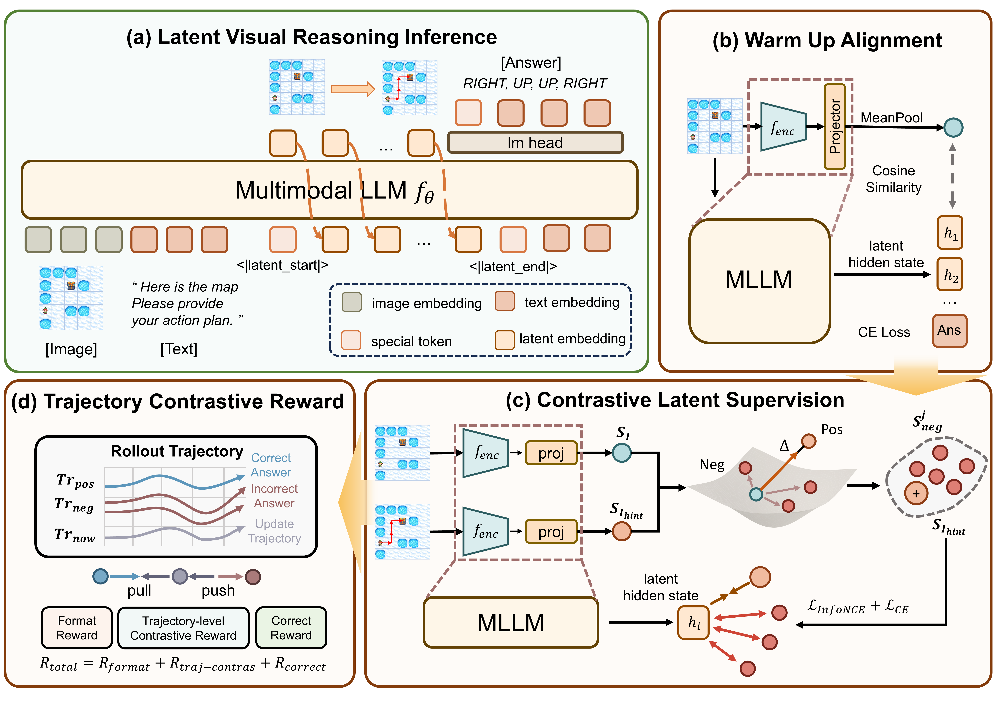

<p align="center">
	<h1 align="center">CoLVR: Enhancing Exploratory Latent Visual Reasoning via Contrastive Optimization </h1>
	<p align="center">
	</p>
    <p align="center">
      <!---<b>Ziyang Ding, Linjian Meng, Yiming Wu, Yuhan Li, Yuhao Liu, Zhen Zhao<sup>†</sup></b>--->
      <p align="center">
        <a href="https://scholar.google.com/citations?user=SuFIjWQAAAAJ&hl=zh-CN/">Ziyang Ding</a>,
        <a href="https://menglinjian.github.io//">Linjian Meng</a>,
        <a href="https://sites.google.com/site/yimingwu0/home/">Yiming Wu</a>,
        <a href="https://github.com/YuhanLeeeee">Yuhan Li</a>,
        <a href="https://yiqian7a.github.io/">Yuhao Liu</a>,
        <a href="http://zhaozhen.me/">Zhen Zhao<sup>†</sup></a>,
      </p>
    </p>
    <p align="center">
        <a href="https://arxiv.org/abs/2605.08802"></a>
        <a href="https://oscar-dzy.github.io/CoLVR-project-page/" target="_blank" rel="noopener noreferrer"></a>
        <a href="https://huggingface.co/collections/Oscar-dzy/colvr-models" target="_blank" rel="noopener noreferrer"></a>
        <a href="https://huggingface.co/datasets/Oscar-dzy/CoLVR-datasets" target="_blank" rel="noopener noreferrer"></a>
<p align="center">
    
</p>


**CoLVR** (**C**ontrastive **O**ptimization for **L**atent **V**isual **R**easoning) enables flexible and exploratory visual reasoning through latent contrastive training. This repository provides the complete **SFT, GRPO training, and evaluation code** for **VSP, Jigsaw, and Tetris**.


## :fire: News

* **[2026.10.11]** Full release! 🎉 We have open-sourced the complete **SFT, GRPO training, and evaluation code** for **VSP, Jigsaw, and Tetris**, together with the unified [CoLVR-datasets](https://huggingface.co/datasets/Oscar-dzy/CoLVR-datasets).
* **[2026.09.25]** Our paper has been accepted to **NeurIPS 2026 as a poster**! 🎉. Many thanks to our advisors and collaborators for their support. Training code and data will be released gradually.
* **[2026.05.12]** Our paper is now available on [arXiv](https://arxiv.org/abs/2605.08802).
* **[2026.05.10]** We released the VSP inference code, [model checkpoints](https://huggingface.co/Oscar-dzy/CoLVR-VSP), and CoLVR-VSP-Bench.

## :clipboard: Abstract

Due to the potential for exploratory reasoning of Latent Visual Reasoning, recent works tend to enable MLLMs (Multimodal Large Language Models) to perform visual reasoning by propagating continuous hidden states instead of decoding intermediate steps into discrete tokens. However, existing works typically rely on **hard alignment** objectives to force latent representations to match predefined visual features, thereby severely limiting the exploratory of latent reasoning process. To address this problem, we propose **CoLVR** (**C**ontrastive **O**ptimization for **L**atent **V**isual **R**easoning). To obtain a more **exploratory visual reasoning**, CoLVR introduces a latent contrastive training framework. Firstly, CoLVR learns diverse and exploratory representations with a latent contrastive objective guided by angle-based perturbation, which expands the semantic latent space and avoids over-constrained embedding. Then, CoLVR employs a latent trajectory contrastive reward for RL (Reinforcement Learning) post-training to enable fine-grained optimization of latent visual reasoning process and thus fostering diverse reasoning behaviors. Experiments demonstrate that CoLVR significantly enhances the exploratory capability of latent representations, achieving average improvements of 5.83% on VSP and 8.00% on Jigsaw, while also outperforming existing latent models on out of domain benchmarks, with a 3.40% gain on MMStar.


## :mag_right: Overview
<details open="open" style='padding: 10px; border-radius:5px 30px 30px 5px; border-style: solid; border-width: 0px;'>
  <summary>Table of Contents</summary>
  <ol>
    <li>
      <a href="#microscope-environment">Environment</a>
    </li>
    <li>
      <a href="#books-data-preparation">Data Preparation</a>
    </li>
    <li>
      <a href="#package-checkpoints">Checkpoints</a>
    </li>
    <li>
      <a href="#muscle-training">Training</a>
    </li>
    <li>
      <a href="#rocket-evaluation">Evaluation</a>
    </li>
    <li>
      <a href="#pen-citation">Citation</a>
    </li>
    <li>
      <a href="#pray-acknowledgement">Acknowledgement</a>
    </li>
  </ol>
</details>


## :microscope: Environment

Set up a Python 3.10 environment for training and evaluation:

```bash
conda create -n colvr python=3.10
conda activate colvr

git clone https://github.com/Oscar-dzy/CoLVR.git
cd CoLVR
pip install -r requirements.txt
```

This installs the bundled Transformers implementation required by CoLVR. Run all commands below from the repository root.


## :books: Data Preparation

Download [CoLVR-datasets](https://huggingface.co/datasets/Oscar-dzy/CoLVR-datasets) from Hugging Face and place the three task folders directly under `data/`. The unified dataset contains SFT, GRPO, and test data for **VSP, Jigsaw, and Tetris**. **CoLVR-VSP-Bench** is included under `vsp_spatial_planning/`, with both seen and unseen test splits.

**Expected Directory Structure:**

```text
data/
├── vsp_spatial_planning/
│   ├── img/
│   ├── grpo_3456/
│   ├── imgs_test_seen/
│   ├── imgs_test_unseen/
│   ├── train_direct.jsonl
│   ├── grpo_direct_3456.jsonl
│   ├── test_direct-seen.jsonl
│   └── test_direct-unseen.jsonl
├── zebra_jigsaw/
│   ├── train_images/
│   ├── train_grpo_images/
│   ├── test_images/
│   ├── train_direct.jsonl
│   ├── train_grpo_direct.jsonl
│   └── test_direct.jsonl
└── zebra_tertis/
    ├── train_images/
    ├── train_grpo_images/
    ├── test_images/
    ├── train_direct.jsonl
    ├── train_grpo_direct.jsonl
    └── test_direct.jsonl
```

Keep the folder name `zebra_tertis` and task identifier `tertis` as used in the code.


## :package: Checkpoints

We have open-sourced the model checkpoints for all three tasks: **VSP, Jigsaw, and Tetris**. Download them from our [CoLVR Models collection](https://huggingface.co/collections/Oscar-dzy/colvr-models) on Hugging Face and follow the evaluation instructions below to evaluate the corresponding task checkpoint.


## :muscle: Training

The training pipeline is **latent warm-up → contrastive SFT → GRPO**. Set the model and output paths in the scripts, and adjust `CUDA_VISIBLE_DEVICES` and `config/default_config.yaml` for your hardware (default: 4 GPUs, BF16). Configure W&B credentials or set `WANDB_MODE=offline` in the scripts.

### SFT

Each script runs both SFT stages through `src/main.py` and `src/trainer.py`. Set `--model` to the base model path, `--save_model_path` for each stage, and Stage 2's `--load_model_path` to the Stage 1 checkpoint.

| Task | Command |
| --- | --- |
| VSP | `bash train-vsp.sh` |
| Jigsaw | `bash train-jigsaw.sh` |
| Tetris | `bash train-tertis.sh` |

### GRPO

In `train-grpo.sh`, set each task's `--load_model_path` to its SFT checkpoint, and configure `--save_model_path` and `--plot_output_dir`. The script runs all three tasks sequentially through `src/grpo_latent_easy.py`, with the latent trajectory contrastive reward enabled. Keep only the desired task block to train a single task.

```bash
bash train-grpo.sh
```


## :rocket: Evaluation

Evaluate SFT or GRPO checkpoints with `src/test.py` using `test-w_3tasks.sh`:

1. Set `model_path` in each task block to the corresponding checkpoint. For Jigsaw and Tetris, configure `cache_dir` and use a separate `output_results_dir` for each task.
2. Enable the task commands you want to run. VSP is enabled by default; uncomment the Jigsaw and Tetris `python src/test.py` blocks to include them.
3. For VSP, select `test_direct-seen.jsonl` or `test_direct-unseen.jsonl` via `data_path` and run each split separately.

```bash
bash test-w_3tasks.sh
```

The script sets `TRANSFORMERS_MAX_LATENT_LEN=8`, with fixed latent steps enabled for VSP and disabled for Jigsaw and Tetris.

VSP reports overall and per-level accuracy in the log. Jigsaw and Tetris also save predictions to `results.json` and accuracy to `metrics.json` under their respective `output_results_dir`.

## :pen: Citation

If you find this work useful, please use the following BibTeX. Thank you for your support!

```latex
@inproceedings{ding2026colvr,
  title = {CoLVR: Enhancing Exploratory Latent Visual Reasoning via Contrastive Optimization},
  author = {Ding, Ziyang and Meng, Linjian and Wu, Yiming and Li, Yuhan and Liu, Yuhao and Zhao, Zhen},
  booktitle = {The Fortieth Annual Conference on Neural Information Processing Systems},
  year = {2026},
  url = {https://openreview.net/forum?id=FdggkQpSHq}
}
```


## :pray: Acknowledgement

We sincerely thank the following open-source repositories and projects for their valuable contributions and support to our work:

- [Transformers](https://github.com/huggingface/transformers)
- [Qwen2.5-VL](https://github.com/QwenLM/Qwen3-VL)
- [Mirage](https://github.com/UMass-Embodied-AGI/Mirage)
- [ILVR](https://github.com/XD111ds/ILVR/tree/main)
- [TRL](https://github.com/huggingface/trl)


